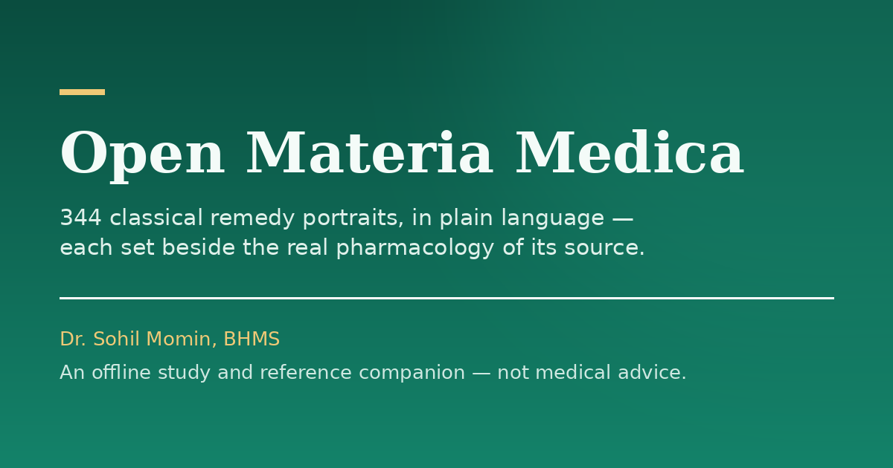

<div align="center">


<h1>Open Materia Medica</h1>

<p><strong>344 remedy portraits, open to everyone.</strong></p>

<p>A free, offline, open-to-everyone materia medica — the classical portraits in<br>
plain language, each one set beside the real pharmacology and toxicology of the<br>
substance it is made from.</p>

<p>
  <a href="https://drsamonline.github.io/open-materia-medica/"></a>
  <a href="https://drsamonline.github.io/open-materia-medica/play/"></a>
  <a href="https://github.com/drsamonline/open-materia-medica/releases/latest"></a>
  <a href="LICENSE"></a>
</p>

<p>
  <a href="https://img.shields.io/github/stars/drsamonline/open-materia-medica?style=for-the-badge"></a>
  <a href="https://img.shields.io/github/forks/drsamonline/open-materia-medica?style=for-the-badge"></a>
  <a href="https://img.shields.io/github/license/drsamonline/open-materia-medica?style=for-the-badge"></a>
  <a href="https://img.shields.io/github/last-commit/drsamonline/open-materia-medica?style=for-the-badge"></a>
  <a href="https://img.shields.io/github/repo-size/drsamonline/open-materia-medica?style=for-the-badge"></a>
</p>

<p>
  <a href="https://drsamonline.github.io/open-materia-medica/"><strong>Landing page &nbsp;→</strong></a>
  &nbsp;&nbsp;·&nbsp;&nbsp;
  <a href="https://drsamonline.github.io/open-materia-medica/play/"><strong>Read the web edition &nbsp;→</strong></a>
  &nbsp;&nbsp;·&nbsp;&nbsp;
  <a href="https://github.com/drsamonline/open-materia-medica/releases/latest"><strong>Download the Android app &nbsp;→</strong></a>
</p>

</div>

> **Where things live.** The project **landing page** is served at
> <https://drsamonline.github.io/open-materia-medica/>. The **web edition**
> itself — the full 344-portrait library — is served at
> <https://drsamonline.github.io/open-materia-medica/play/>, and its source
> lives in [`docs/play/`](docs/play/).

---

<div align="center">


<p><strong>The classical homeopathic materia medica, in plain language.</strong></p>

<p>344 remedy portraits — each one set beside the real pharmacology and<br>
toxicology of the substance it is made from.</p>

<p>The free web edition of, and offline Android companion app to, the book<br>
by <strong>Dr. Sohil Momin, BHMS</strong>.</p>

<p>
  <a href="https://drsamonline.github.io/open-materia-medica/"></a>
  <a href="https://github.com/drsamonline/open-materia-medica/releases/latest"></a>
  <a href="https://github.com/drsamonline/open-materia-medica/releases"></a>
  <a href="LICENSE"></a>
</p>

<p>
  <a href="https://developer.android.com/"></a>
  
  
  
</p>

<p>
  
  
  
</p>

<p>
  <a href="https://drsamonline.github.io/open-materia-medica/play/"><strong>Read it online &nbsp;→</strong></a>
  &nbsp;&nbsp;·&nbsp;&nbsp;
</p>



</div>

---

A plain-language **materia medica** as a self-contained, offline-capable static
website and installable PWA — and an Android app that carries the whole library
in your pocket. No build step, no server, no tracking, no accounts.

> **Educational reference only — not medical advice.** Severe, sudden or
> worsening symptoms need a qualified clinician.

## What makes it different

Most materia medica flattens three very different kinds of statement into one
confident voice. This one refuses to, and the separation is structural — it is
built into the shape of every single chapter.

| | | |
|---|---|---|
| **Classical claim** | what the old books say a remedy answers | tradition and testimony — **not** evidence that it works |
| **Pharmacological fact** | what is established about the source *substance* | real science, but about the substance, not a preparation of it |
| **Clinical evidence** | what trials of preparations themselves show | the hardest test, including the null results |

A substance's pharmacology can be perfectly real while telling you nothing
whatever about the remedy made from it. Keeping the three apart is the point.

## What's inside

Every remedy page opens with a **source illustration** and the **essence**, then
runs through the same blocks: **the traditional picture** (inner state → body →
modalities → organ affinities) → **where the classical picture comes from** →
**the substance in real medicine** → **look-alikes** → a **safety** note.

| Path | What it is |
|---|---|
| `index.html` | Home / remedy index — all 344 portraits, one line each |
| `search.html` | Offline full-text search across every portrait |
| `diseases.html` | 66 conditions with their most-used remedies (jump-links) |
| `repertory.html` | Mini-repertory: the most-used rubrics with first remedies |
| `quick-reference.html` | The daily-practice fifty, plus every Boericke remedy in one line |
| `compare.html` | Any two portraits side by side |
| `study.html` | Study app — flashcards and self-test over the library |
| `kingdoms.html` | The remedies by kingdom, with a distribution chart |
| `families.html` | Sixteen natural families (snakes, spiders, the Kali family, …) |
| `veterinary.html` | Animal conditions by species |
| `agro.html` | Agro-homeopathy: crop, pest and storage problems |
| `glossary.html` | 34 classical terms in plain words |
| `evidence.html` | The research debate on ultra-dilute preparations, gathered neutrally |
| `references.html` | Every source, cited once site-wide |
| `basics.html` | Read this first — the beginner's primer |
| `about.html` | The user guide — how to read a remedy page |
| `compiled-by.html` | The compiler's page |
| `license.html` | Licence and rights of use |
| `remedies/*.html` | The 344 remedy portraits |

## Get the Android app

The companion app bundles this entire site and runs it offline — no network, no
server, works in aeroplane mode.

**Install it** — download [`OpenMateriaMedica-1.0.apk`](https://github.com/drsamonline/open-materia-medica/releases/latest)
(2.4 MB, Android 7.0+) and open it on the phone. Allow installation from
unknown sources for the app you are opening it with.

**Or build it** — the project lives in [`android/`](android/) and has **no
dependencies**: no AndroidX, no Compose, no libraries. The only code is a single
`WebView` activity.

```bash
cd android
./sync-assets.sh        # copies the site from the repo root into the app
./gradlew assembleDebug # or open the folder in Android Studio
```

`sync-assets.sh` exists because the site lives once, at the repository root —
running it is what keeps the app and the website from drifting apart.

## Run it locally

No build step. Serve the folder with anything:

```bash
python3 -m http.server 8080     # then open http://localhost:8080
```

Opening `index.html` straight from disk also works for browsing and search —
the index loads as a script, not a `fetch`. Only the install prompt needs a
server.

## Hosting

It is a **static site** — drop the folder on any web host (GitHub Pages,
Netlify, Cloudflare Pages, a plain Apache/Nginx directory).

**Live at** <https://drsamonline.github.io/open-materia-medica/> — served from
this repository by GitHub Pages, straight from the default branch. What is
committed is what is served.

Served over `https`, it installs to a phone's home screen and works with no
network at all: the service worker caches the entire library.

## Assets

| File | Purpose |
|---|---|
| `assets/style.css` | The whole design system (one stylesheet) |
| `assets/site.js` | Mobile nav, active-link highlight, back-to-top, reading bar, service worker |
| `assets/search-index.js` | The offline search index, loaded as a JS global so search works from `file://` too |
| `assets/icon.svg`, `assets/favicon.svg` | App icon and favicon |
| `assets/icon-192.png`, `assets/icon-512.png` | Raster icons for the app manifest and launchers |
| `assets/og.png` | Social preview card |
| `sw.js`, `manifest.json` | Service worker and web-app manifest — the offline install |

## Editing

- **Text and content** live directly in the HTML files. Remedy pages share one
  structure, so a find-and-replace across `remedies/` is safe.
- **Navigation and footer** are a single canonical block repeated in every page.
  To add a page, copy the `<header class="site">…</header>` and
  `<footer class="site">…</footer>` block from any existing page and adjust the
  `href` prefixes (`../` inside `remedies/`).
- **The search index** is generated from the remedy pages. After editing
  remedies, rebuild `assets/search-index.js` so search stays current.
- **Colours and typography** are tokens at the top of `assets/style.css`
  (`--accent`, `--paper`, `--serif`, …). Change them there and the whole site
  follows.

## Sources

The classical portraits are drawn from public-domain editions of **Boericke,
Clarke, Kent, Allen, Nash and Farrington**; the modern pharmacology and the
research debate are cited on `references.html` and discussed on `evidence.html`.

## Licence and rights

© 2026 **Dr. Sohil Momin, BHMS**. All rights reserved. This work — text, design
and code — is watermarked and fingerprinted. Unauthorised copying,
redistribution or rebranding is prohibited. See [`LICENSE`](LICENSE).

**The classical sources are not covered by this copyright.** Copyright subsists
in the original work of compilation, arrangement and description only. The
classical materia medica drawn upon is in the public domain, and no claim is
made to it.

---

<div align="center">
  <sub>Compiled by <strong>Dr. Sohil Momin, BHMS</strong> · Vadodara, India</sub><br>
  <sub>Educational reference only — not medical advice.</sub>
</div>
